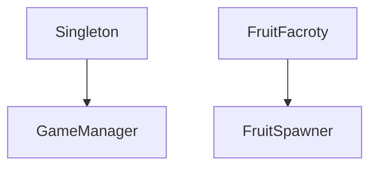

# INFR 3110 Make Up Assignment
---
### Name : Yushan Zulipukaer
### Student Number : 100985617
---
# Object Oriented Programming
---
### Description
  I implemented the inheritance on singleton. First I coded a script called Singleton and let the coded GameManager:Singleton. Also, used this on factory pattern.
## UML Diagram

---
# Singleton Pattern
---
### Purpose
  There is only one object that manage the factory pattern or other functions. Doesn't need to instantiate one every time.
### Implementation
  Using abstract class called singleton and make gamemanager inherit from it to make sure there is only one game manager and destroy other ones who claims.
---
# Factory Pattern
---
### Purpose
 Seperate the function from the object itself and let the GameManager to control some functions.
### Implementation
 Created a interface first and let the factory to inherit. Created a factory script to set the instantiate location. Created and attached a spawner on the GameManager which doesn't care what is it spawning. We just need to 
attach the object we want to spawn into the blank.
---
# References
---
<!-- Identify sources used to create any gameplay logic or programming pattern
implementations. -->
